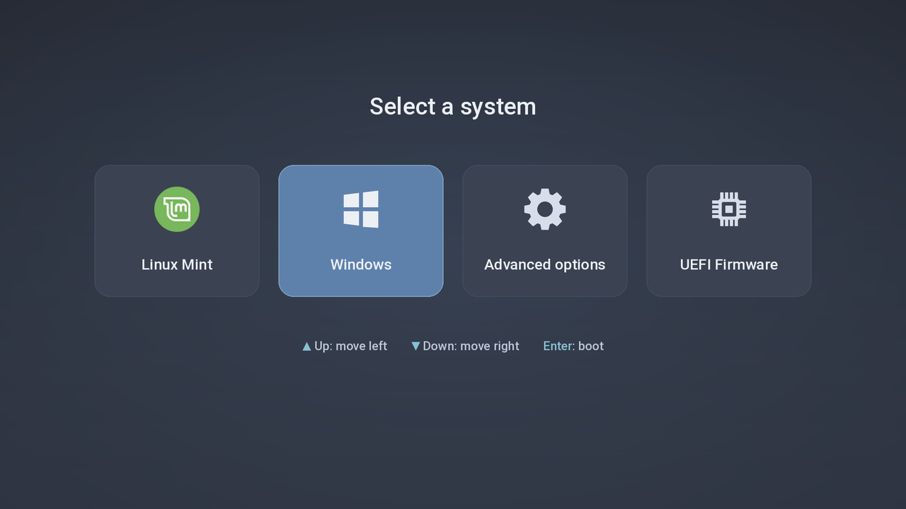

# Nord GRUB cards — for portrait-native panels

A GRUB theme in the [Nord](https://www.nordtheme.com) palette that is **readable on laptops/handhelds
whose screen is natively portrait** (built and tested on the **GPD MicroPC 2**, 1080×1920 panel used in landscape).



## The problem it solves

On those devices the firmware hands GRUB a 1080×1920 framebuffer, so a normal theme appears rotated 90°,
and GRUB has no way to rotate text. This theme works around it:

- the background and every card (icon + entry name) are **pre-rotated images**, so they look upright in landscape;
- GRUB's own item text is painted in the card colour (invisible), so only the upright images show;
- selection is a rounded Nord-blue card.

## Install

```bash
python3 build.py                        # needs Pillow; builds ./theme with a Nord gradient background
# python3 build.py --wallpaper my.jpg   # or use your own wallpaper (blurred + darkened)
sudo bash install.sh                    # copies to /usr/share/grub/themes/nord-cards, sets GRUB_THEME, update-grub
```

`install.sh` backs up `/etc/default/grub` first and sets `GRUB_GFXMODE=1080x1920,auto`.

## Keys (important)

The framebuffer is portrait, so the list that GRUB lays out top→bottom appears **left→right** in landscape:

| Key | Does |
|-----|------|
| **Up** | move selection **left** |
| **Down** | move selection **right** |
| **Enter** | boot |

Left/Right keys cannot be used: stock GRUB ignores Left and treats Right as Enter.

## Limitations / honesty

- Calibrated on one device. It assumes the image must be rotated **90° clockwise** (panel "right side up").
  If it shows upside-down on yours, change `to_portrait`/`pos_portrait` in `build.py`.
- The four cards (**Linux Mint, Windows, Advanced options, UEFI Firmware**) are fixed images in that order.
  If your `grub.cfg` has a different set/order, edit `LABELS`, the icon list in `main()` and `N`, then rebuild.
- GRUB paints later-declared components *under* earlier ones; `theme.txt` is generated accordingly.

## Credits

Icons from [vinceliuice/grub2-themes](https://github.com/vinceliuice/grub2-themes) (GPL-3.0), Roboto font (Apache-2.0),
Nord palette (MIT). See `NOTICE`. Licensed GPL-3.0 (see `LICENSE`).
